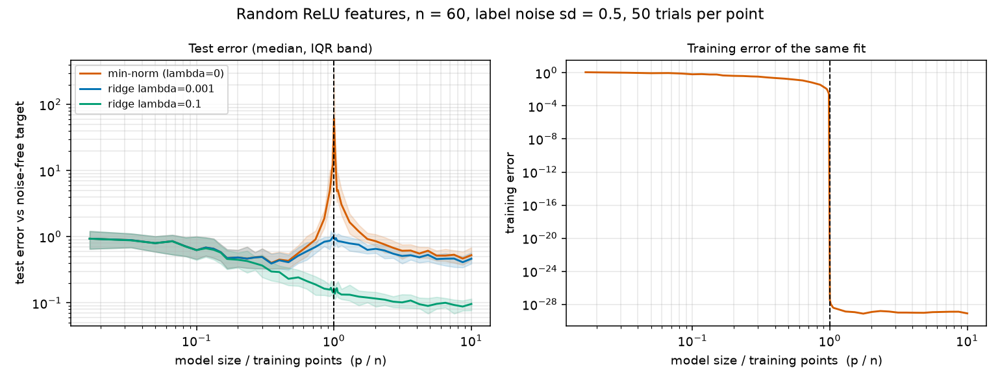

# 02 - Double descent with random features

**Question.** If you keep adding parameters to a model that already fits its training data perfectly, does test error keep rising? And what does a little regularisation do to the picture?

Classical statistics says test error is U-shaped in model size. Modern overparameterised models seem to break that: error spikes where the model first becomes able to interpolate the training data, then falls again as it grows further. This experiment reproduces the effect in the smallest setting we could find, where everything can be computed exactly.

## Setup

- **Data.** n = 60 training points with 10-dimensional Gaussian inputs. The target is a random linear function of the input plus Gaussian label noise (sd 0.5). Test error is measured on 2000 fresh points against the noise-free target.
- **Model.** p random ReLU features, `relu(W x) / sqrt(p)` with fixed random `W`. Only the output weights are fitted, by least squares.
- **Fits.** Three variants: the minimum-norm solution (`lambda = 0`, which is also what gradient descent from zero converges to), and ridge regression with `lambda = 0.001` and `lambda = 0.1`. All are computed exactly with the SVD.
- **Sweep.** p from 1 to 600 (dense around p = n = 60), 50 independent trials per point (new data, new teacher, new random features each time). We plot medians with the interquartile range, because the error near p = n has a heavy tail.

## Reproduce

```bash
python -m venv .venv && source .venv/bin/activate
pip install -r requirements.txt

python test_experiment.py            # sanity checks, a few seconds
python experiment.py                 # about 15 s on a laptop-class CPU
python experiment.py --noise 0 --out results/noise0                  # no label noise
python experiment.py --noise 1.0 --n-train 100 --out results/noisy   # another variation
```

Everything is seeded (`--seed`, default 0). Outputs: `results/summary.csv` and `results/double_descent.png`. The committed files are from the plain `python experiment.py` command, plus the `--noise 0` run in `results/noise0/`.

## Results



Median test error against the noise-free target:

| Fit | Best (p) | Worst (p) | At p = 600 (10x n) |
|-----|----------|-----------|--------------------|
| min-norm (lambda = 0) | 0.40 (p = 21) | 61.5 (p = 60) | 0.53 |
| ridge lambda = 0.001  | 0.39 (p = 21) | 0.99 (p = 59) | 0.47 |
| ridge lambda = 0.1    | 0.088 (p = 519) | 0.93 (p = 1) | 0.096 |

What stands out:

1. **The spike sits exactly on the interpolation threshold.** For the minimum-norm fit, median test error is 12.5 at p = 59, 61.5 at p = 60 and 21.7 at p = 61, against about 0.4 for a small model. Training error falls from about 3e-3 at p = 59 to about 1e-28 at p = 60: from p = n onwards the model fits the noisy labels perfectly.
2. **Past the threshold, error comes back down.** By p = 600 the median is 0.53, close to where the small models were, even though the model interpolates the noise. The very best minimum-norm model in this sweep was still a small one (p = 21), so more parameters did not win here; they just stopped hurting.
3. **A little ridge goes a long way.** `lambda = 0.001` cuts the worst case from 61.5 to 0.99 (about 60 times lower), though a visible bump remains near p = n. `lambda = 0.1` removes the bump altogether, and with it test error keeps improving with model size, ending about 5.5 times lower than the minimum-norm fit at p = 600.

## Limits of this experiment

- The spike is driven mostly, but not only, by label noise. With `--noise 0` (committed in `results/noise0/`) the minimum-norm peak falls from 61.5 to 2.8 and the error at p = 600 falls to 0.004, but a spike remains at p = n. A likely reason is that ReLU features cannot represent the linear teacher exactly, and that mismatch acts like noise; this experiment does not test that explanation.
- Linear teacher, one input dimension, one noise level, one sample size. We have not shown how the effect depends on any of them.
- The ridge strengths (0.001, 0.1) were picked by eye, not tuned on held-out data, so "lambda = 0.1 is best" is not a general statement.
- Random features are not trained neural networks. The same shape appears in trained networks, but this experiment does not show that.
- 50 trials per point. The spike's height is heavy-tailed, so the median (and IQR) is what we plot; the mean would be dominated by a few trials.

## Things to try

- Vary the noise: `--noise 1`, `--noise 2`. How do the spike height and the best model size move?
- Find out why a spike survives at `--noise 0`: make the teacher exactly representable by the features and see whether it disappears.
- Pass more ridge strengths: `--lams 0,1e-6,1e-4,1e-2,1`.
- Replace the linear teacher with a nonlinear one in `one_trial`.
- Change the input dimension `--d`, or the sample size `--n-train`, and check that the spike follows p = n.
- Swap ReLU for another feature map (cosine features, say) in `make_features`.

## Files

| File | What it is |
|------|------------|
| `experiment.py` | Data, features, exact ridge/min-norm fit, sweep, plots and command line |
| `test_experiment.py` | Checks the fit against `lstsq`, `pinv` and the closed-form ridge solution |
| `requirements.txt` | NumPy and Matplotlib |
| `results/` | CSV and figure from the default command |
